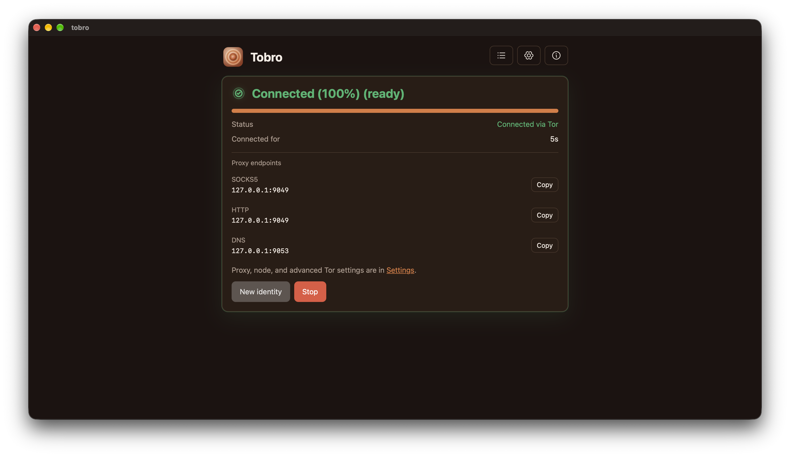
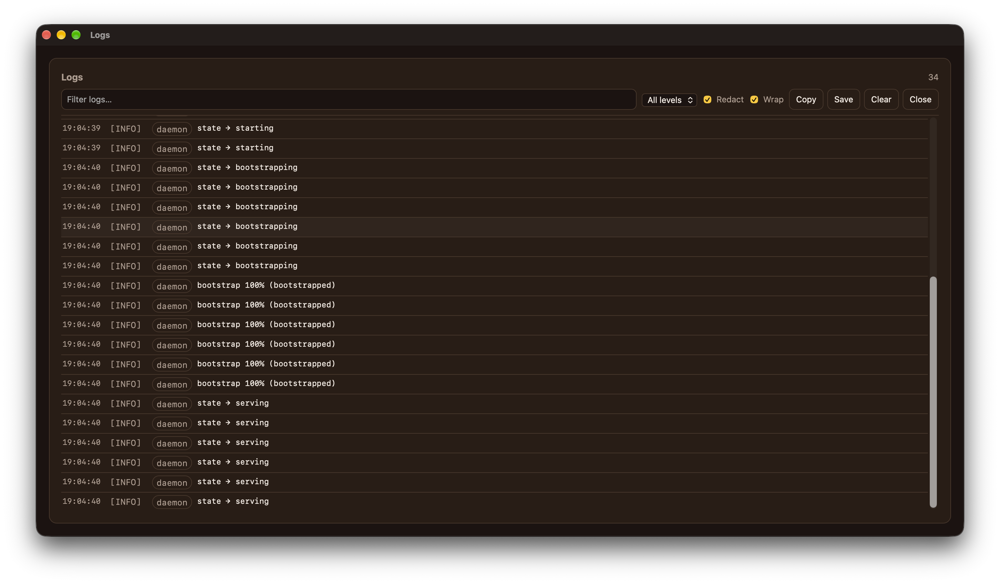
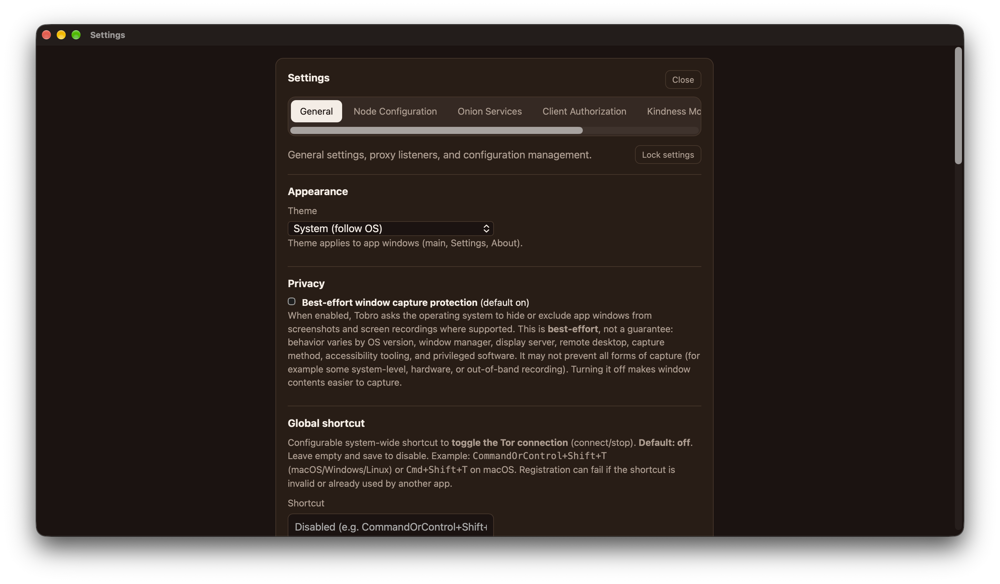
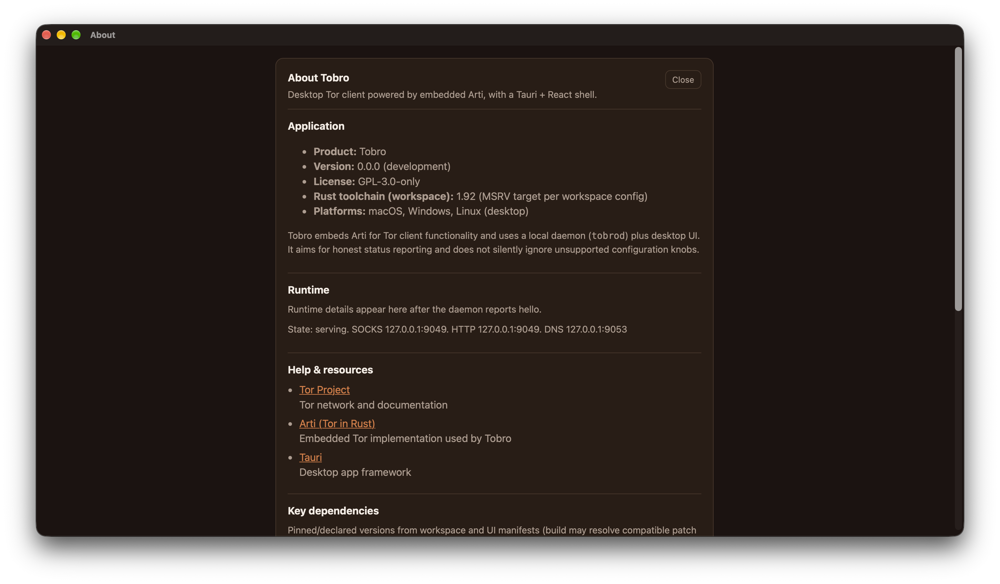

# Tobro

A ground up, native, and desktop-only implementation of the Tor client using modern
technologies that reproduces the useful surface of Orbot using Rust/Arti and Tauri.
Supports connect/disconnect, bridges and pluggable transports, local proxy services,
onion hosting, Kindness Mode, as well as numerous circumvention methods.

**Status:** M0-M6 shipped; M7 in progress.

- [Read the full plan](TOBRO_PLAN.md) — architecture, technology decisions, Orbot feature-parity matrix, milestones, and risks.

## Screenshots

| | |
|---|---|
|  |  |
|  |  |

## Features

### Core Tor connectivity

- One-click connect/stop with live bootstrap progress, structured state
  machine, and automatic reconnect after network loss (guards preserved).
- **New identity** on demand: fresh circuits without dropping guard state.
- Embedded Arti 2.8 client inside the `tobrod` daemon; the GUI talks to it
  over local JSON-RPC only — the UI can crash without touching the network.

### Local proxy services

- **SOCKS5** and **HTTP CONNECT** listeners with configurable ports,
  conflict detection, and a next-free-port helper.
- **DNS proxy** for `.onion` resolution and SOCKS-side destination handling.
- Opt-in **bind-all-interfaces** mode with explicit firewall warnings.
- **Stream isolation** options: isolate by destination address, port, and/or
  client protocol; upstream SOCKS credentials get their own circuit by default.

### Circumvention and bridges

- Bridge lines with **lyrebird** (`obfs4`, `meek_lite`/`meek`, `webtunnel`),
  **snowflake-client** (`snowflake`, including AMP cache, front, and broker
  parameters), and **dnstt-client** (`dnstt`).
- **Moat** bridge fetching: request fresh bridges by country and transport,
  with automatic fallback to the bundled built-in distribution.
- Bundled built-in bridge distribution; per-transport and per-country filters.
- Bridge tooling: validate/normalize/import/export lines, live transport
  diagnostics via `bridges.test`, and redacted export for safe sharing.

### Power-user networking

- Explicit **exit-country selection**, IPv6 prefer/only/disable, and default
  stream preferences; unsupported knobs are hidden with explanations rather
  than silently ignored.
- Full **config engine**: validate/apply JSON patches, redacted config reads
  (no secrets), import/export without key material, live reload.

### Outbound proxy (upstream)

- Route Tor itself through an upstream **HTTP/SOCKS** or **Shadowsocks**
  proxy (`sslocal` sidecar) — useful when the local network requires a
  corporate or residential proxy first.
- Upstream **auth secrets live in the OS keychain**, never in the config file;
  set/clear them from the settings window without exposing passwords in logs.

### Onion services (hosting)

- Host v3 onion services with arbitrary port mappings
  (`VIRT[:TARGET_HOST]:TARGET`); create/edit/enable/disable/delete at runtime.
- Published `.onion` addresses push to the UI as events; key material is
  stored in a 0700 managed directory, never in config plaintext.
- **Client authorization:** generate x25519 credentials, import/export
  standard `.auth_private` files, attach/detach credentials per service
  (restricted-discovery mode).
- **Encrypted backups:** passphrase-protected bundles of service keys and
  client-auth credentials, restorable to another machine.

### Kindness Mode (Snowflake proxy)

- Donate bandwidth to censored users by running a `snowflake-proxy` sidecar
  supervised by the daemon (start/stop, crash backoff, capacity caps).
- **Limits:** optional pause rules stop and later resume the proxy with no
  bandwidth donated while the rule holds: metered connections (Linux
  detection) and battery power (macOS/Linux detection); enforced only when
  the platform positively reports the condition, so unknowns never pause.
- **Eligibility check** before enabling: STUN-based NAT type detection,
  UPnP gateway/external-IP discovery with port-map setup for the ephemeral
  range, and broker reachability — reported as actionable items (firewall,
  symmetric NAT, conflicting VPN) rather than raw errors.
- **Stats:** connection counts are gathered from the proxy's own log output
  (per-connection events, so nothing else is counted): currently open
  connections (volatile, resets with the daemon) plus weekly and all-time
  served totals stored in the local database. Counts are numbers only: no
  client addresses, labels, or countries; reset clears them for good.
- Honest diagnostics: no invented connectivity claims; states are
  `direct`/`nat`/`unknown` with per-server consistency labels.

### Desktop experience

- Tray-first app: window hides to tray on close; quit from the tray menu.
- **App lock** with lock-on-idle and lock-on-close, preferring OS
  authentication (password fallback available).
- **Autostart** with start-to-tray/minimized mode.
- Separate **floating logs window** with filtering, redaction, copy, and save.
- Settings windows (general, node configuration, onion services, client
  authorization, Kindness Mode, advanced Tor config) with a power-user gate.
- Connection view with bootstrap progress, circuit/identity controls, and
  reachable-daemon fallback.

### CLI (`tobroctl`)

Full headless control with JSON output and stable exit codes:

```text
status · start · connect · stop · shutdown · new-identity · reload-config · logs · watch
config       get / validate / apply
diagnostics  export (redacted bundle: status, config, onion, kindness, logs)
bridges      validate / import / builtin / export / apply / test / moat
onion        list / create / update / enable / disable / delete / backup / restore
client-auth  list / generate / import / export / delete / attach / detach
```

`start` launches the daemon headless and detached and waits for its IPC
endpoint; `logs` reads the daemon's in-memory redacted log ring buffer;
`diagnostics export` produces a shareable, redacted JSON bundle. `watch`
streams daemon notifications (state, bootstrap, onion publish) as JSON lines —
suitable for scripting and CI checks. See [docs/headless.md](docs/headless.md)
for the full headless guide (systemd/launchd examples included).

### Security & privacy posture

- No telemetry anywhere; diagnostics are redacted locally before display.
- Secrets (outbound proxy passwords, onion service keys, client-auth
  credentials) live in the OS keychain or 0700 managed directories.
- Log redaction is enforced by tests; config reads are redacted by default.
- Local-only IPC (Unix domain socket / named pipe); the daemon runs and
  restarts independently of the GUI.

## At a glance

- **Tor:** Arti 2.8 (embedded) via `tobrod` daemon + Tauri/React desktop app.
- **Platforms:** macOS, Windows, Linux.
- **Crates:** `tobro-tor` (wrapper), `tobro-config`, `tobro-ipc`,
  `tobro-store`, `tobrod`, `tobroctl`.
- **Non-goals:** mobile, relay/exit, `torrc` compatibility, bundled browser.

## Platform support

Tobro targets macOS, Windows, and Linux. Most features are cross-platform; the
table below calls out where the underlying OS mechanism differs or where a
feature is not (yet) available on a given OS.

| Feature | macOS | Windows | Linux |
|---|---|---|---|
| Core Tor connectivity (Arti 2.8, connect/new identity) | ✅ | ✅ | ✅ |
| SOCKS5 / HTTP CONNECT / DNS proxy listeners | ✅ | ✅ | ✅ |
| Bridges & pluggable transports (obfs4, meek, webtunnel, snowflake, dnstt) | ✅ | ✅ | ✅ |
| Moat + built-in bridge distribution | ✅ | ✅ | ✅ |
| Onion services, client authorization, encrypted backups | ✅ | ✅ | ✅ |
| Kindness Mode (snowflake proxy, eligibility check, stats) | ✅ | ✅ | ✅ |
| Kindness pause: on battery power | ✅ (`pmset`) | ❌ (unknown, never pauses) | ✅ (`/sys/class/power_supply`) |
| Kindness pause: metered connection | ❌ (unknown, never pauses) | ❌ (unknown, never pauses) | ✅ (NetworkManager) |
| Local IPC to `tobrod` | Unix domain socket | Named pipe | Unix domain socket |
| Secrets in the OS keychain (`keyring`) | Keychain | Credential Manager | Secret Service¹ |
| Autostart + start-to-tray | LaunchAgent (`~/Library/LaunchAgents`) | Run key (`HKCU\…\Run`) | systemd user unit |
| Tray-first GUI, floating logs window, settings | ✅ | ✅ | ✅ |
| App lock (password, lock-on-idle/close) | ✅ | ✅ | ✅ |
| App lock via OS auth (Touch ID / Windows Hello) | ❌ (planned; password fallback) | ❌ (planned; password fallback) | ❌ (planned; password fallback) |
| Window capture protection | Best-effort | Best-effort | Best-effort (varies by DE/WM) |
| Headless daemon + `tobroctl` | ✅ (launchd example) | ✅ | ✅ (systemd example) |
| TUN mode + privileged helper (`tobro-helper`) | 🚧 M7 in progress (utun + PF_ROUTE + SC DNS + PF kill switch) | 🚧 M7 in progress (wintun + iphlpapi + WFP kill switch) | 🚧 M7 in progress (netlink + TUN + blackhole-route kill switch) |
| System proxy integration / proxy env vars | ❌ (planned post-1.0) | ❌ (planned post-1.0) | ❌ (planned post-1.0) |

¹ Requires a running Secret Service provider (GNOME Keyring, KWallet). When no
keychain is available, secrets are not persisted.

Pause rules for Kindness Mode are enforced only when the platform positively
reports the condition, so `❌` above never stops bandwidth donation — the state
is simply reported as "unknown" in the UI.

## Core state machine

```text
        ┌──────────┐   start   ┌───────────┐  bootstrap  ┌───────────────┐
        │ Stopped  ├──────────►│ Starting  ├────────────►│ Bootstrapping │
        └────▲─────┘           └─────┬─────┘             └──────┬────────┘
             │                       │ error                    │ 100%
             │ stop                  ▼                          ▼
        ┌────┴─────┐           ┌───────────┐             ┌────────────┐
        │ Stopping │◄──────────┤  Error    │             │  Connected │
        └──────────┘   stop    └───────────┘             └─────┬──────┘
                                                               │ network loss
                                                               ▼
                                                        ┌─────────────┐
                                                        │ Reconnecting│
                                                        └─────────────┘
```

## System overview

```text
┌──────────────────────────────────────────────────────────────────┐
│                        User session                              │
│                                                                  │
│  ┌────────────────────┐        JSON-RPC 2.0        ┌───────────┐ │
│  │  tobro GUI         │◄──────────────────────────►│  tobrod   │ │
│  │  Tauri 2 + React   │   UDS / named pipe         │  daemon   │ │
│  │  tray, windows     │   events + commands        │           │ │
│  └────────────────────┘                            └─────┬─────┘ │
│                                                          │       │
│  ┌────────────────────┐                                  │       │
│  │  tobroctl CLI      │◄─────────────────────────────────┤       │
│  └────────────────────┘                                  │       │
│                                                          │       │
│                                          ┌───────────────┼───────┐
│                                          │               │       │
│                                    ┌─────▼─────┐   ┌─────▼─────┐ │
│                                    │  Arti     │   │ PT manager│ │
│                                    │  client   │   │ sidecars  │ │
│                                    └─────┬─────┘   └─────┬─────┘ │
│                                          │               │       │
│                                    ┌─────▼───────────────▼─────┐ │
│                                    │  Tor network (bridges)    │ │
│                                    └───────────────────────────┘ │
│                                                                  │
│  ┌─────────────────────────────┐        ┌──────────────────────┐ │
│  │  tobro-helper (privileged)  │◄──────►│  TUN / routes / DNS  │ │
│  │  optional, TUN mode only    │        │  (post-1.0)          │ │
│  └─────────────────────────────┘        └──────────────────────┘ │
└──────────────────────────────────────────────────────────────────┘
```

## Bridges (lyrebird / snowflake)

Enable bridges in `config.toml` and provide bridge lines. tobro resolves PT
binaries and configures Arti transports:

- **lyrebird**: `obfs4`, `meek_lite` (`meek` alias), `webtunnel` (`transport_path` / `transport_dir`)
- **snowflake-client**: `snowflake` (`snowflake_path` / `snowflake_dir`); AMP/front/broker/STUN/UTLS settings are passed via bridge-line parameters (including AMP cache rendezvous where supported by the client)
- **dnstt-client**: `dnstt` bridge lines
- **Moat** fetching: request fresh bridges by country/transport with fallback
  to the bundled built-in distribution

Smart Connect (automatic direct/bridge fallback) is planned.

```toml
[bridges]
enabled = true
lines = [
  "obfs4 192.0.2.1:443 FINGERPRINT cert=... iat-mode=0",
  "Bridge webtunnel 192.0.2.2:443 FINGERPRINT url=https://example.com/ ver=0.0.1",
  "Bridge snowflake 192.0.2.3:80 FINGERPRINT fingerprint=FINGERPRINT url=https://snowflake-broker.torproject.net/ front=cdn.sstatic.net ampcache=https://cdn.ampproject.org/ utls-imitate=hellorandomizedalpn",
]
# transport_path = "/path/to/lyrebird"           # optional (lyrebird)
# snowflake_path = "/path/to/snowflake-client"   # optional
```

## CLI commands

Headless quickstart (see [docs/headless.md](docs/headless.md) for the full
guide and service-manager examples):

```sh
cargo run -p tobroctl -- start          # spawn `tobrod run` detached, wait for IPC
cargo run -p tobroctl -- status         # JSON status (stopped until connected)
cargo run -p tobroctl -- connect        # start Tor/bootstrap + local listeners
cargo run -p tobroctl -- logs           # recent, redacted daemon logs (JSON)
cargo run -p tobroctl -- shutdown       # disconnect Tor and exit the daemon
cargo run -p tobroctl -- diagnostics export --out diag.json   # redacted bundle
```

Manual control (daemon in the foreground, e.g. under a service manager):

```sh
# terminal 1: start the control plane (loads config/store, idle until connect)
cargo run -p tobrod -- run

# terminal 2: control the daemon
cargo run -p tobroctl -- status         # JSON status (stopped until connected)
cargo run -p tobroctl -- connect        # start Tor/bootstrap + local listeners
cargo run -p tobroctl -- status         # should become serving/connected when ready
cargo run -p tobroctl -- new-identity   # request new circuits (preserves guards)
cargo run -p tobroctl -- reload-config  # reload/validate config from disk
cargo run -p tobroctl -- config get     # redacted config (no secrets)
cargo run -p tobroctl -- config validate '{"proxy":{"socks_port":9050}}'
cargo run -p tobroctl -- config apply '{"proxy":{"socks_port":9050,"bind_all_interfaces":false}}'
cargo run -p tobroctl -- stop           # disconnect Tor
cargo run -p tobroctl -- watch          # stream state/bootstrap notifications

# onion services
cargo run -p tobroctl -- onion list
cargo run -p tobroctl -- onion create --name web --port 80:8080
cargo run -p tobroctl -- client-auth generate --nickname laptop
cargo run -p tobroctl -- onion backup --out backup.json --passphrase '…'

# bridge helpers
cargo run -p tobroctl -- bridges validate @bridges.txt
cargo run -p tobroctl -- bridges moat --country de --transport obfs4
cargo run -p tobroctl -- bridges apply @bridges.txt

# runtime checks (boots Tor, serves listeners)
cargo run -p tobrod -- spike --exit-after-check
# opt-in .onion resolution check through the local DNS proxy (UDP; needs live Tor + a reachable target)
cargo run -p tobrod -- spike --exit-after-check --timeout-secs 300 --dns-check-host <v3-onion-hostname>.onion
```

### Desktop app options

```sh
# Start the GUI hidden to the tray (used by autostart/start-minimized)
cargo run -p tobro -- --minimized
# equivalent
cargo run -p tobro -- --hidden
```

`tobrod run` starts stopped; use `connect` to start Tor. `tobroctl` prints JSON to
stdout and diagnostics to stderr (exit `0` on success, `1` on error). The IPC
endpoint defaults to `<platform data dir>/tobro/state/tobrod.sock`; pass
`--socket <path>` to both commands when using custom dirs. For daemon
management (`start`/`logs`/`diagnostics export`/`shutdown`), headless
deployment, and service-manager units, see [docs/headless.md](docs/headless.md).

The spike bootstraps Arti, prints JSON-line bootstrap events to stdout, fetches
a page through Tor, starts SOCKS/HTTP on `9050` and DNS on `9053`, then fetches
a page through the local SOCKS listener. Drop `--exit-after-check` to keep
serving until Ctrl-C. Use `--state-dir`/`--cache-dir` for checkout-local Arti
state, and `--dns-check-host` for an explicit DNS/`.onion` resolution check.

## Desktop app

```sh
# install frontend dependencies once
cd apps/desktop/ui && bun install

# install the Rust Tauri CLI once (provides `cargo tauri`)
cargo install tauri-cli --version "^2.0.0" --locked

# run the Tauri shell from the repo root
cargo tauri dev --config apps/desktop/tauri.conf.json
# alternative (uses @tauri-apps/cli from apps/desktop/ui):
# cd apps/desktop/ui && bun run tauri dev --config ../tauri.conf.json
# or, if you built the UI and want the Rust side only:
# (cd apps/desktop/ui && bun run build) && cargo run -p tobro
```

The GUI tries to start `tobrod` automatically when the daemon is not reachable.
It looks for `tobrod` next to the app binary, via `TOBROD_PATH`, or on `PATH`,
and starts it as `tobrod run --socket <path>`. For development, make sure the
daemon binary is built (for example `cargo build -p tobrod`) so the GUI can find
it. You can still run the daemon manually: `cargo run -p tobrod -- run`.

The shell connects to `tobrod` over local IPC (default platform state path, or
`--socket <path>`), shows status/bootstrap progress, provides Connect/Stop/New
identity, full settings (listeners, outbound proxy, exit country and IP
version, onion services, client authorization, Kindness Mode, stream
isolation, and advanced Tor config), and a floating logs
window (filter/redact/copy/save). If `tobrod` is not running, the GUI attempts
to start it automatically. The window hides to the tray on close; quit from the
tray menu to exit the GUI. The daemon is independent.

## License

[GPL-3.0-only](LICENSE.txt).
